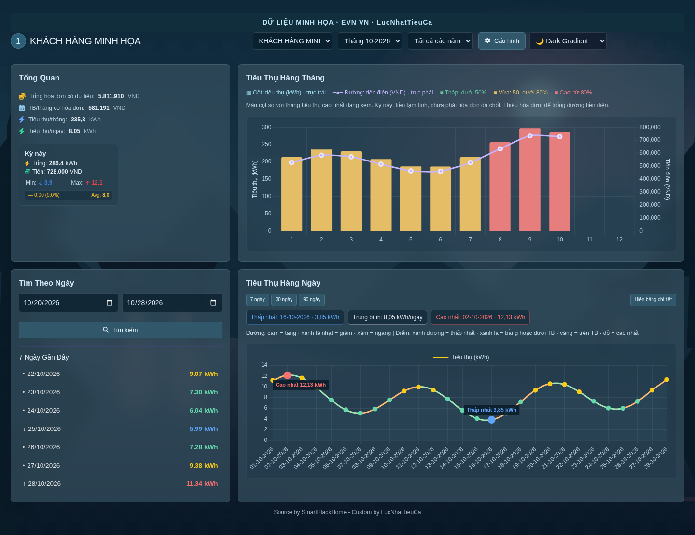
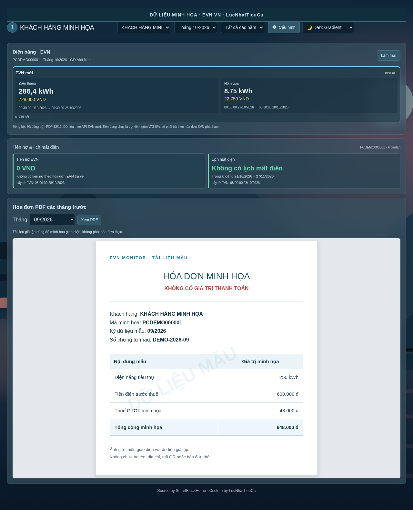

# EVN VN

Source by SmartBlackHome - Custom by LucNhatTieuCa

Theo dõi điện EVN CPC miền Trung trong Home Assistant, cài qua HACS và không cần add-on. Hỗ trợ mã khách hàng bắt đầu bằng `PC`; chưa hỗ trợ các miền khác.

## Hình ảnh minh họa

Ảnh được dựng từ giao diện của integration với **dữ liệu giả lập**, không chứa tài khoản, số liệu điện hay hóa đơn cá nhân.

**Tổng quan và biểu đồ điện năng theo tháng/ngày**

**Điện năng, tiền nợ, lịch mất điện và bố cục xem hóa đơn**

Tài liệu trong ảnh là mẫu dựng minh họa, không phải hóa đơn EVN phát hành và không có giá trị thanh toán.

## Cài đặt

Yêu cầu Home Assistant 2026.10 trở lên. Trong HACS, thêm URL `https://github.com/LucNhatTieuCa/EVN` ở **Custom repositories**, loại **Integration**, tải EVN VN và khởi động lại Home Assistant. Vào **Cài đặt → Thiết bị & dịch vụ → Thêm tích hợp → EVN VN**, nhập tài khoản EVN.

Integration tự lấy mọi mã CPC liên kết với tài khoản, bỏ qua mã đã có và tạo entry/sensor lần lượt. Không cần nhập từng mã. Nếu EVN yêu cầu CAPTCHA hoặc đổi mật khẩu, hoàn tất trên ứng dụng EVN rồi thử lại.

Mở **EVN Monitor** ở thanh bên để xem số liệu và tiến trình. Mỗi mã có tên riêng; có thể đổi trong Cấu hình. Chỉ mã đã chọn sensor Electric Meter mới có khung đối chiếu Electric.

## Khởi tạo và cập nhật

Lần đầu lấy dữ liệu hiện tại để tạo sensor trước, sau đó nhập lịch sử nền: danh mục hóa đơn, chỉ số tháng theo từng năm, chỉ số ngày theo cửa sổ 15 ngày và toàn bộ PDF mà EVN còn cung cấp. Mỗi đợt xử lý tối đa 2 năm, 4 cửa sổ ngày hoặc 8 PDF, nghỉ 60 giây giữa các đợt. Các mã dùng chung hàng đợi; không gọi đồng loạt.

Tiến trình hiển thị giai đoạn, năm đang quét và PDF đã lưu/tổng số. PDF EVN không còn cung cấp được ghi riêng và thử lại sau 7 ngày; không coi là đã tải. Tắt hoặc khởi động lại HA sẽ tiếp tục từ điểm dừng đã lưu. Quét ngày dừng khi gặp hai cửa sổ liên tiếp không có dữ liệu; điều này phản ánh giới hạn dữ liệu trả về, không bảo đảm EVN giữ toàn bộ lịch sử từ ngày ký hợp đồng.

Sau khởi tạo, điện năng/nợ/lịch mất điện cập nhật mỗi 4 giờ; Electric mỗi 15 phút. Chỉ số ngày lấy vùng mới gần nhất và đối soát tháng mỗi ngày. Danh mục hóa đơn đối soát mỗi ngày; chỉ PDF còn thiếu/mới được tải. Một số API EVN vẫn trả cả danh sách hóa đơn trong một response vì không có phân trang/incremental đã xác minh; integration không thể yêu cầu máy chủ chỉ trả phần mới.

Mọi request đăng nhập/dữ liệu/PDF được xếp hàng, cách nhau ít nhất 2 giây. Lỗi mạng hoặc 5xx thử lại có giới hạn; 429 tuân thủ thời gian nghỉ của máy chủ, tối thiểu 60 giây. Lỗi đăng nhập/403 không thử liên tiếp. Cơ chế này giảm tải; không bảo đảm EVN không thay đổi API hoặc giới hạn tài khoản. Lịch sử dài có thể cần nhiều giờ và dung lượng lưu PDF tương ứng.

## Số liệu và cách tính tiền

EVN API mới là chuẩn mốc đầu kỳ, tổng điện tháng và mốc chốt ngày. Electric dùng chỉ số riêng của sensor tại cùng mốc thời gian EVN; không trừ chỉ số của hai công tơ khác nhau. Nếu thiếu gốc đáng tin cậy thì không ép thành 0; gốc xấp xỉ được ghi rõ.

Tiền ngày = tiền lũy kế đến cuối ngày − tiền lũy kế đến đầu ngày, gồm VAT. Ví dụ đã dùng 95 kWh, dùng thêm 10 kWh: 5 kWh bậc 2 và 5 kWh bậc 3. Đổi khoảng biểu đồ không khởi động lại bậc thang.

Biểu giá cấu hình cho điện sinh hoạt một hộ được kiểm tra với hóa đơn API. VAT được đối chiếu từ số tiền trước thuế/thuế/tổng hóa đơn. Nếu chưa có hóa đơn phù hợp hoặc giá không khớp, để trống dự tính tiền và yêu cầu kiểm tra; không tự suy ra toàn bộ biểu giá mới từ một tổng tiền. Hộ nhiều định mức, điện kinh doanh, thay giá giữa kỳ hoặc điều chỉnh hóa đơn có thể cần bổ sung biểu giá riêng. Tiền thực trả theo hóa đơn EVN.

## Dữ liệu và gỡ cài đặt

Dữ liệu nằm trong thư mục `evnvn` dưới thư mục cấu hình HA: SQLite `evndata.db`, PDF trong `invoices`, thông tin đăng nhập trong `private/credentials.json` có quyền chỉ chủ sở hữu đọc/ghi. Mật khẩu không trả về WebUI và không nằm trong config entry; file gốc vẫn là dữ liệu nhạy cảm và phải được bảo vệ cùng backup HA. Lịch sử đổi thông tin đăng nhập được mã hóa, khóa lưu tách khỏi bản mã trong khu vực riêng.

Tên khách hàng, lựa chọn sensor và gốc Electric dùng HA Store. Reload, tắt entry hoặc khởi động lại HA giữ dữ liệu. **Xóa config entry EVN sẽ xóa dữ liệu của mã đó**, gồm entity/sensor do integration tạo, lịch sử điện/hóa đơn/PDF, tên riêng, cấu hình đối chiếu và thông tin đăng nhập của mã. Helper Utility Meter cũ chỉ được dọn khi đối chiếu đúng mapping, tên EVN, nguồn và entity sở hữu. Các mã khác, helper tự tạo và sensor công tơ vật lý được chọn làm nguồn không bị xóa.

**Xóa entry EVN cuối cùng sẽ xóa toàn bộ thư mục dữ liệu `evnvn`, kho đăng nhập EVN và HA Store của integration.** HA Recorder được yêu cầu xóa lịch sử và thống kê của các entity EVN đã gỡ; tiến trình purge chạy trong Recorder. Backup HA và snapshot quản trị ngoài cây dữ liệu đang chạy vẫn giữ nguyên. Cài lại cần đăng nhập và tải lại dữ liệu EVN. Hãy backup trước khi xóa entry.

Gỡ mã bằng HACS khác với xóa config entry trong Thiết bị & dịch vụ: hãy xóa entry trước, rồi mới gỡ mã trong HACS để HA còn chạy được hook dọn dữ liệu.
Không đưa thư mục cấu hình, database, PDF, mật khẩu, ảnh hóa đơn hoặc backup cá nhân vào GitHub.

## Thư viện

PDF.js, Chart.js, Tailwind CSS và Font Awesome được đóng gói kèm phiên bản cố định. Các giấy phép tương ứng được giữ tại `webui/assets/vendor`. Những thông báo bản quyền/giấy phép thư viện không phải ghi chú dư thừa và không bị xóa.

## Hướng dẫn và hỗ trợ

- [Cài đặt, nâng cấp và khôi phục](docs/INSTALL.md)
- [Xử lý lỗi và báo lỗi an toàn](docs/TROUBLESHOOTING.md)
- [Trạng thái và checklist phát hành](docs/RELEASE.md)

Từ bản 2026.10.28.5, domain và thư mục chương trình là `evn`. Nếu đang dùng domain `npc`, xem hướng dẫn chuyển đổi trong INSTALL.md trước khi nâng cấp. Repository private không dùng được với HACS; cần repository công khai để cài qua Custom repositories.

## Tiến trình khởi tạo

EVN Monitor có khung **Đồng bộ dữ liệu** riêng cho mã đang xem và tổng số PDF của các mã đã cấu hình. Khung hiển thị giai đoạn, số PDF đã lưu/tổng/còn thiếu, phần trăm PDF đã lưu, số bản ghi tháng/ngày, thời điểm cập nhật và thời gian thử lại nếu nguồn tạm nghỉ. Tổng dữ liệu chưa xác định được để trống; PDF EVN chưa cung cấp không được tính là đã tải. Không thể biết trước tổng lịch sử ngày mà nguồn còn giữ, nên phần trăm chỉ áp dụng cho danh mục PDF đã xác định.

Mỗi mã có hai sensor chẩn đoán **Đồng bộ dữ liệu** và **Tiến độ tải PDF**. Thuộc tính ghi số đã lưu/còn thiếu, giai đoạn, lỗi và mốc thử lại. Dữ liệu lịch sử cập nhật lên sensor sau từng đợt, độc lập với quá trình tải PDF. Theo dõi tiến trình chỉ đọc SQLite tại HA, không tăng lượt truy vấn EVN; lịch truy vấn điện năng bốn giờ được giữ.

Khung tiến trình tự ẩn khi mã đang xem đã hoàn tất xử lý dữ liệu có thể tải. Khung hiện lại khi có việc mới hoặc lỗi/tạm nghỉ; các sensor chẩn đoán vẫn được giữ. PDF nguồn không cung cấp vẫn được ghi riêng, không tính là đã tải.
